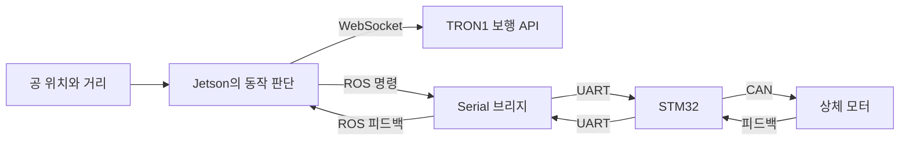

# RoboCup 로봇 통합제어

서울시립대학교 ZETIN의 RoboCup 2026 프로젝트에서 사용한 경기 제어 코드와 상체 제어 예제, 상하체 로봇 모델을 정리했습니다.

김민성은 16명 팀의 전체 팀장과 통합제어를 맡았습니다. ROS 명령을 STM32의 모터별 CAN 명령으로 연결하고 피드백을 받는 코드를 구현했습니다. TRON1 보행 API에 상체 동작을 연동했고, 공 인식부터 킥까지 실물 동작을 확인했습니다. 팀은 2026 한국 로보컵 오픈 Soccer Humanoid-Kids 부문 1위를 수상하고 같은 해 세계대회에 출전했습니다.

비전과 기구 설계는 팀 공동 작업입니다. 이 저장소에는 통합 동작을 이해하는 데 필요한 팀 코드가 함께 들어 있습니다.

## 코드 보기

| 폴더 | 내용 | 먼저 볼 파일 |
|---|---|---|
| [competition](competition) | 경기 운용 v10.4.2 계열. 인식 결과와 경기 상태를 받아 보행과 상체 동작 결정 | [ball_follower_integrated.py](competition/ball_follower_integrated.py) |
| [ros1](ros1) | 모터 명령/피드백 메시지, STM32 브리지, 상체 시험 | [mit_bridge_node.py](ros1/src/tron_upper_body/scripts/bridges/mit_bridge_node.py) |
| [models](models) | TRON1 하체에 상체를 결합한 URDF와 MuJoCo 모델 | [robot.urdf](models/SF_TRON1B/urdf/robot.urdf) |

## 제어 구조



## 로봇 없이 확인하기

Python과 NumPy가 설치된 환경에서 다음 기존 검사를 실행할 수 있습니다.

```bash
cd competition
python -m pip install numpy
python selftest.py
```

가상 인식 결과와 가상 구동기를 사용합니다. 탐색에서 접근, 방향 조정, 킥으로 이어지는 상태 전이와 관측값을 확인합니다. 실제 카메라, ROS 통신, 로봇 구동은 각 장비가 필요합니다.

## 실행 환경과 모델

실기 코드는 ROS1, RealSense, STM32와 TRON1 통신 환경을 전제로 합니다. 파일별 모터 ID와 관절 방향은 개발 시기에 따라 다릅니다. 해당 파일의 설정을 실제 기구와 대조해야 합니다.

URDF와 MuJoCo 파일은 관절 구조를 보여 주는 모델 정의입니다. 참조하는 메시가 포함돼 있지 않아 이 저장소만으로 완전한 시뮬레이션을 실행할 수는 없습니다.

[경기 코드 설명](competition/README.md) · [ROS1 설명](ros1/README.md) · [모델 설명](models/README.md) · [검사 결과](docs/CHECKS.md) · [출처](NOTICE.md)
