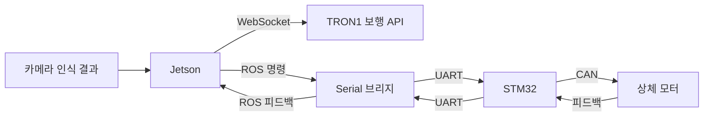

# RoboCup 제어 코드

서울시립대학교 ZETIN에서 RoboCup 2026을 준비하며 작성한 코드입니다. 공을 찾고, 다가가고, 차는 동작을 구현하기 위해 TRON1 하체에 팀에서 제작한 상체와 카메라를 연결했습니다.

하체 이동은 TRON1의 보행 API를 사용하고, 상체 모터는 STM32를 거쳐 CAN으로 제어합니다. 이 저장소에는 제어 코드와 함께 연동에 사용한 팀의 비전 코드와 로봇 모델을 담았습니다.

## 코드 둘러보기

| 코드 | 내용 |
|---|---|
| [full_controll.py](ros1/src/tron_upper_body/scripts/competition-websocket/full_controll.py) | 한국대회 6모터 구성. 공 탐색·접근·킥과 상체 동작을 연결한 코드 |
| [mit_bridge_node.py](ros1/src/tron_upper_body/scripts/bridges/mit_bridge_node.py) | ROS 모터 명령을 STM32 Serial 패킷으로 보내고 피드백을 받는 브리지 |
| [upper-body-8motor](ros1/src/tron_upper_body/scripts/upper-body-8motor) | 팔꿈치를 추가한 뒤 모터 응답과 상체 동작을 확인한 시험 코드 |
| [competition](competition) | 세계대회 준비 중 추가한 비전 연동, 상태 머신, GameController 처리 코드 |
| [models](models) | 상하체의 링크와 관절을 정의한 URDF·MuJoCo 파일 |

한국대회에서는 터미널로 Stand/Walk를 준비한 뒤 공 탐색부터 접근·킥까지 동작을 확인했습니다. 이후 세계대회를 준비하며 인식 모듈을 분리하고 경기 상태 처리를 추가했습니다. `competition`은 그 과정의 개발본으로, 자율 경기 전체를 검증한 배포본은 아닙니다.

## 장치 연결



## 로봇 없이 실행해 보기

```bash
cd competition
python -m pip install numpy
python selftest.py
```

가상 공·골대 관측과 `DryRunDriver`로 상태 전이를 확인합니다. 실제 카메라나 로봇에는 연결하지 않습니다. 검사 범위는 [CHECKS.md](docs/CHECKS.md)에 정리했습니다.

## 장비에서 실행할 때

ROS1, RealSense, STM32, TRON1이 필요합니다. 6모터와 8모터 코드는 개발 시기가 달라 파일별 모터 ID와 관절 방향을 먼저 맞춰야 합니다. 구형 코드의 `best.pt`와 로봇 모델의 메시 파일은 포함하지 않았습니다.

설정과 실행 방법은 [ROS1](ros1/README.md), [경기 제어](competition/README.md), [로봇 모델](models/README.md) 문서에 나눠 적었습니다. 팀 작업 범위와 외부 모델의 출처는 [NOTICE.md](NOTICE.md)에서 확인할 수 있습니다.
